# Azure DevOps & DevOps Engineering:

>A structured record of the DevOps concepts, Azure DevOps services, and infrastructure practices.


---

## Table of Contents

- [Overview](#overview)
- [Architecture](#architecture)
- [Components](#components)
  - [1. Software Delivery Lifecycle](#1-software-delivery-lifecycle)
  - [2. Planning with Azure Boards](#2-planning-with-azure-boards)
  - [3. Source Control with Git](#3-source-control-with-git)
  - [4. Build Pipelines and Continuous Integration](#4-build-pipelines-and-continuous-integration)
  - [5. Release Pipelines and Deployment](#5-release-pipelines-and-deployment)
  - [6. Containers](#6-containers)
  - [7. Infrastructure as Code](#7-infrastructure-as-code)
  - [8. Configuration Management](#8-configuration-management)
  - [9. Deployment Strategies](#9-deployment-strategies)
  - [10. Package Management with Azure Artifacts](#10-package-management-with-azure-artifacts)
  - [11. Security and Compliance](#11-security-and-compliance)
  - [12. Testing with Azure Test Plans](#12-testing-with-azure-test-plans)
  - [13. Monitoring and Instrumentation](#13-monitoring-and-instrumentation)
  - [14. Project Administration](#14-project-administration)
- [Workflow](#workflow)
- [Prerequisites](#prerequisites)
- [Installation](#installation)
- [Configuration](#configuration)
- [Usage](#usage)
- [Architecture Diagram](#architecture-diagram)
- [Best Practices](#best-practices)
- [Troubleshooting](#troubleshooting)
- [References](#references)
- [Conclusion](#conclusion)
- [Author](#author)

---

## Overview

DevOps is a way of working that brings development and operations together so that software can be planned, built, tested, released, and observed as one continuous loop rather than as hand-offs between separate teams.

This repository is my consolidated reference for that topic. It covers the full path a change takes in a modern Azure-based delivery process:

1. Capturing requirements and managing work.
2. Versioning source code with Git.
3. Automating builds and tests (CI).
4. Releasing to multiple environments (CD).
5. Provisioning infrastructure from code.
6. Securing, testing, and monitoring the result.

**What this document is:** a learning portfolio and quick-reference guide. Each section explains a concept, shows how the pieces fit together, and includes runnable snippets and diagrams I drew myself.

**Topics covered:** Agile and Scrum, Azure Boards, Git workflows, Azure Pipelines, Docker, ARM/Bicep, Terraform, DSC, VM Scale Sets, blue-green and canary releases, Azure Artifacts, Key Vault, OWASP ZAP, Azure Test Plans, Azure Monitor, Log Analytics, and Application Insights.

---

## Architecture

The high-level picture of the delivery system I have been studying:

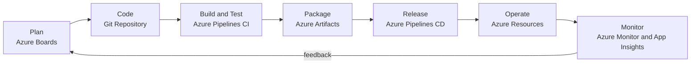

### From waterfall to DevOps

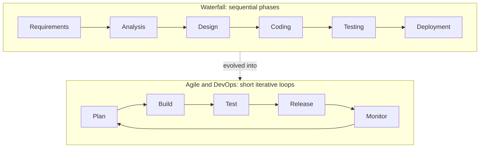

---

## Components

### 1. Software Delivery Lifecycle

<details>
<summary><b>Waterfall vs Agile vs DevOps (click to expand)</b></summary>

#### Waterfall

Work moves through fixed phases in order: planning, requirements, analysis, design, coding, testing, deployment.

| Strengths | Weaknesses |
|---|---|
| Clear boundaries between phases | Customers often see the product only at the very end |
| Requirements are settled early | Scope changes are expensive |
| Easy for managers to estimate dates and cost | Defects tend to surface late, during testing |

#### Agile

Agile favors short iterations, close collaboration with users, and continuous improvement. The Agile Manifesto (2001) was written by a group of practitioners who wanted a lighter alternative to heavyweight processes.

#### Scrum

Scrum is an Agile framework built on fixed-length iterations called sprints.

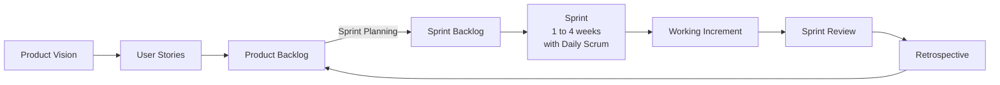

| Artifact / Event | Meaning |
|---|---|
| **User story** | A feature described from the user's point of view |
| **Product backlog** | Ordered list of everything that might be built, owned by the product owner |
| **Sprint backlog** | The subset of backlog items the team commits to for one sprint |
| **Sprint review** | Demo of completed work; decide whether it is ready for production |
| **Retrospective** | Team discussion about what worked and what did not |

#### The Dev vs Ops problem

In traditional setups developers want to ship features quickly, while operations teams want stability. Rushed fixes and shortened testing make operations hesitant to deploy, because any failure lands on them as downtime. DevOps exists to remove this tension through shared ownership, automation, and shared tooling.

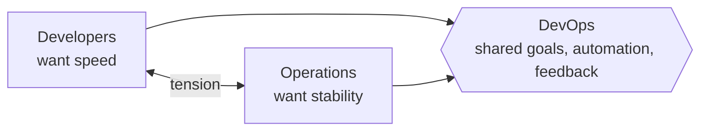

</details>

---

### 2. Planning with Azure Boards

<details>
<summary><b>Work items, Kanban, and permissions</b></summary>

Azure Boards is the work-tracking service of Azure DevOps. It supports Scrum and Kanban views and lets a team trace work from idea to release.

**Core ideas**

- An **organization** groups related projects (for example, one per business unit).
- A **project** holds the repos, boards, pipelines, wiki, and test plans. Creating a project also creates a default team of the same name.
- **Epics** group related **user stories**. Stories are broken down into tasks and moved across a Kanban board (New, Active, Resolved, Closed).

**Example backlog**

| Epic | User story |
|---|---|
| Job postings | Each department admin can add a job posting |
| Job postings | Job postings follow a built-in approval workflow |
| Job postings | Published postings cannot be edited |

**Permissions**

- A new user is placed in a default security group.
- Permissions can be granted at organization, project, or object level.
- Common project groups: Readers, Contributors, Project Administrators, Build Administrators, Release Administrators, Project Valid Users.

**Access levels**

| Level | What it gives |
|---|---|
| Stakeholder | Free, limited access to Boards and Pipelines; no repo access |
| Basic | Most Azure DevOps features, excluding Test Plans |
| Basic + Test Plans | Basic plus full Test Plans capability |
| Visual Studio subscriber | Determined by the user's Visual Studio subscription |

Users can be Microsoft accounts or GitHub identities and are then assigned to projects.

**Integrations:** Azure Boards can post updates into Microsoft Teams so the team sees work-item changes in their chat channels.

#### Queries, dashboards, and widgets

- Everyone except Readers can create personal queries under **My Queries**.
- Saving under **Shared Queries** needs Project Administrator rights plus Basic access or higher.
- Dashboards are visible to Project Valid Users; managing a team dashboard needs Basic access or higher.

| Widget | Purpose |
|---|---|
| Burndown | Remaining work over a period |
| Cycle time | Time from work starting to work closing |
| Lead time | Time from creation to closing |
| Velocity | How much the team completes sprint after sprint |

Other dashboard building blocks include charts based on work-item queries, widgets, and in-context reports generated by the services themselves.

#### Project wiki

Each project can have a wiki backed by a Git repository. Contributors can add and edit pages; at least Basic access is needed, and publishing code as a wiki requires the Create Repository permission.

</details>

---

### 3. Source Control with Git

<details>
<summary><b>Version control, the three areas, branching, and tagging</b></summary>

#### Why version control

It tracks every change to every file, supports rolling back to an earlier state, and allows many developers to work on the same codebase safely.

#### Centralized vs distributed

| | Centralized (Subversion, TFVC) | Distributed (Git) |
|---|---|---|
| History | Lives on a central server | Full copy on every machine |
| Local copy | One working version of each file | Entire repository |
| Editing | Files are checked out from the server | Commit locally, sync later |
| Permissions | Can be set per file (TFVC) | Set per repository or branch |
| Branching | Heavier | Lightweight and fast |

#### The three areas of Git

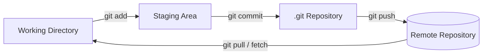

#### Essential commands

```bash
git init                         # create a new local repository
git add .                        # stage changes
git commit -m "Describe change"  # record a snapshot
git log --oneline --graph        # view history
git clone <repo-url>             # copy a remote repository
git push origin main             # publish commits
```

#### Branching and merging

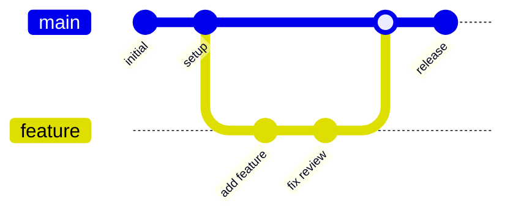

- A **fast-forward merge** happens when `main` has not moved since the feature branch was created: Git simply moves the `main` pointer to the latest feature commit.
- A **three-way merge** creates a merge commit when both branches have new work.

#### Branching strategy guidelines

1. Keep `main` stable and always releasable.
2. Treat `main` as the source of production code.
3. Use a dedicated branch for each feature or bug fix.
4. Merge through pull requests with review.
5. Keep feature branches short-lived.
6. With release branches, make sure fixes land on both the release and main branches.

#### Tags

Tags mark important commits such as releases.

| Type | Description |
|---|---|
| **Lightweight** | Just a pointer to a commit |
| **Annotated** | A full object in Git's database with tagger name, email, date, and message; checksummed and signable with GPG |

```bash
git tag v1.0.0                              # lightweight
git tag -a v1.1.0 -m "Release 1.1.0"        # annotated
git push origin --tags
```

</details>

---

### 4. Build Pipelines and Continuous Integration

<details>
<summary><b>CI concepts, YAML pipelines, and agents</b></summary>

**Continuous Integration (CI)** means every code change is automatically built and tested when it is pushed. Small, frequent integrations make problems easy to locate; a change batch that took weeks to prepare is far harder to debug than a single change from two days.

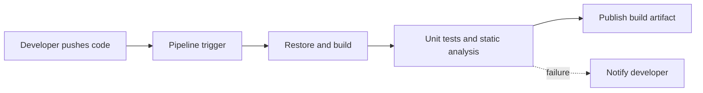

#### Azure Pipelines basics

- Supports CI and CD for many languages (for example .NET, Java, Python, PHP, Ruby, Node.js).
- Can deploy to many target types.
- Pipelines can be written in **YAML** (stored as `azure-pipelines.yml` and versioned with the code) or built in the **classic** graphical editor.
- Pipelines can be triggered from Azure Repos, GitHub, or external CI servers such as Jenkins.

#### Example YAML pipeline (ASP.NET Core)

```yaml
trigger:
  - main

pool:
  vmImage: 'ubuntu-latest'

variables:
  buildConfiguration: 'Release'

steps:
  - task: UseDotNet@2
    displayName: 'Install .NET SDK'
    inputs:
      packageType: 'sdk'
      version: '6.x'

  - task: DotNetCoreCLI@2
    displayName: 'Build'
    inputs:
      command: 'build'
      projects: '**/*.csproj'
      arguments: '--configuration $(buildConfiguration)'

  - task: DotNetCoreCLI@2
    displayName: 'Run unit tests'
    inputs:
      command: 'test'
      projects: '**/*Tests.csproj'
```

#### Agents

| Agent type | When to choose it |
|---|---|
| **Microsoft-hosted** | Simplest option. A fresh VM is created per job and discarded afterwards; Microsoft handles maintenance and upgrades |
| **Self-hosted** | You need custom software, persisted build state or caches, or specific network access |

#### Variables and variable groups

- Variables let you define a value once and reuse it. Values can change between runs or jobs, and the most locally scoped definition wins.
- **Variable groups** store shared values and secrets that multiple pipelines in a project can use; they can also be managed with the Azure CLI.

```bash
az pipelines variable-group list --org <org-url> --project <project>
```

</details>

---

### 5. Release Pipelines and Deployment

<details>
<summary><b>Stages, approvals, gates, and deployment groups</b></summary>

A release pipeline takes a build artifact and promotes it through environments.

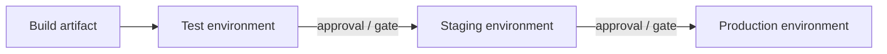

| Control | Purpose |
|---|---|
| **Pre-deployment approval** | A person validates the change before it enters a stage |
| **Post-deployment approval** | A person signs off before the release moves on |
| **Pre-deployment gate** | Automated check, for example no active blocking work items |
| **Post-deployment gate** | Automated check, for example no open issues linked to the deployment |

**Deployment groups** let you target many machines at once. An agent is installed on each VM, and the VMs are registered in a group that a release stage deploys to.

**Example two-task release (web app plus database)**

1. Build the ASP.NET Core application.
2. Release stage runs two tasks:
   - Deploy the schema and data to Azure SQL Database.
   - Deploy the application package to Azure Web App.

**Deployment targets:** Azure VMs, Azure Web Apps, Azure Kubernetes Service, container instances.

</details>

---

### 6. Containers

<details>
<summary><b>Docker image workflow and container jobs</b></summary>

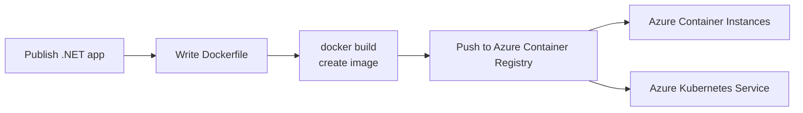

```dockerfile
FROM mcr.microsoft.com/dotnet/aspnet:6.0
WORKDIR /app
COPY ./publish .
EXPOSE 80
ENTRYPOINT ["dotnet", "MyApp.dll"]
```

```bash
docker build -t myapp:1.0 .
az acr login --name <registry>
docker tag myapp:1.0 <registry>.azurecr.io/myapp:1.0
docker push <registry>.azurecr.io/myapp:1.0
```

**Container jobs in pipelines:** instead of relying on the tools installed on the agent, a job can run inside a container that bundles exactly the tools the build needs. This gives consistent, reproducible build environments.

</details>

---

### 7. Infrastructure as Code

<details>
<summary><b>Why IaC, ARM templates, Bicep, and Terraform</b></summary>

#### The problem with manual infrastructure

Creating resources by hand is hard to repeat across environments, easy to misdocument, and slow to change. **Infrastructure as Code** describes resources in files that can be reviewed, versioned, shared, and re-run.

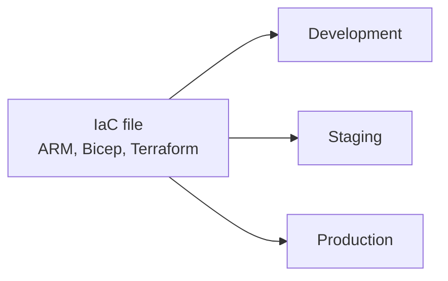

Scripting alternatives include Azure CLI and Azure PowerShell modules.

#### ARM templates and Bicep

- An ARM template is a JSON file declaring Azure resources (virtual networks, VMs, SQL databases, web apps, and so on).
- **Bicep** is a newer language with the same capabilities and a cleaner syntax.
- Large templates can be split using **nested** templates (child definitions inside the main template) or **linked** templates (separate files referenced from a parent).

| Deployment mode | Behavior |
|---|---|
| **Incremental** | Deploys the resources in the template; leaves other resources in the group untouched |
| **Complete** | Resource group ends up containing only what is in the template; other resources are deleted |

```bash
az deployment group create \
  --resource-group my-rg \
  --template-file main.bicep \
  --mode Incremental
```

#### Terraform

Terraform is an open-source, declarative IaC tool from HashiCorp that works across many cloud platforms. Its configuration language is human-readable and it has a large community.

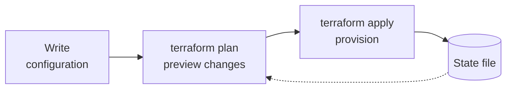

| Term | Meaning |
|---|---|
| **Configuration** | The Terraform-language files describing desired infrastructure |
| **Provider** | A plugin that lets Terraform talk to a platform such as Azure |
| **State** | Terraform's record of what it manages, used to compute plans |

```hcl
terraform {
  required_providers {
    azurerm = {
      source = "hashicorp/azurerm"
    }
  }
}

provider "azurerm" {
  features {}
}

resource "azurerm_resource_group" "rg" {
  name     = "demo-rg"
  location = "North Europe"
}
```

```bash
terraform init
terraform plan
terraform apply
```

</details>

---

### 8. Configuration Management

<details>
<summary><b>DSC, VM extensions, and scale sets</b></summary>

#### Desired State Configuration (DSC)

Machines need specific software and settings (for example IIS for a web app). If configuration drifts, the application can break. **PowerShell DSC** describes the desired state, and **Azure Automation DSC** provides a pull server so that registered machines continually receive and enforce their configuration, all manageable from the Azure portal.

#### VM extensions

The **Custom Script Extension** downloads and runs scripts on a VM, typically for post-deployment tasks such as installing IIS and the ASP.NET hosting bundle, or registering the machine with a deployment group.

#### Virtual Machine Scale Sets

A scale set manages a group of identical VMs behind a load balancer and automatically adds or removes instances based on metrics and conditions.

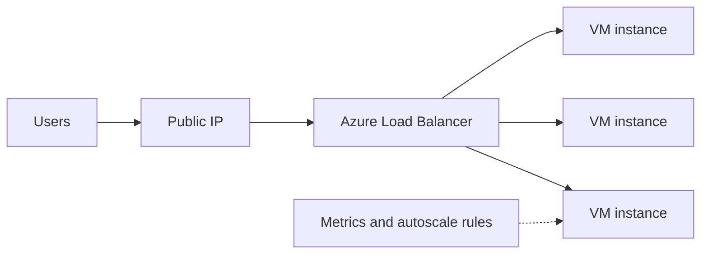

The **Application Health extension** lets the scale set monitor each instance, supporting safe rolling upgrades and automatic instance repair.

</details>

---

### 9. Deployment Strategies

<details>
<summary><b>Blue-green, slots, canary, rolling, and Traffic Manager</b></summary>

Changes carry risk: a bad release can take an application offline and hurt customers. These patterns reduce that risk.

#### Blue-green

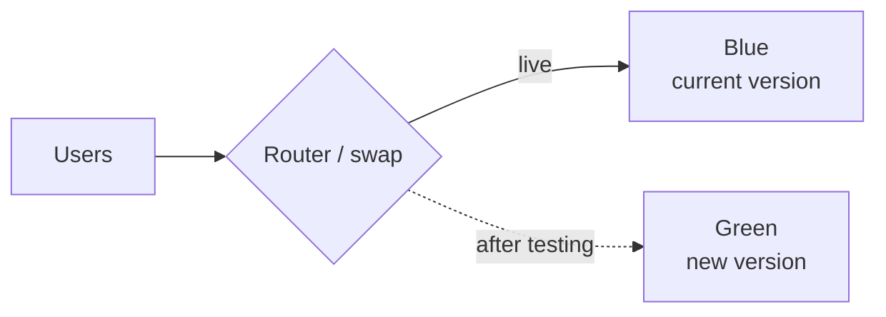

The new version is deployed to an idle duplicate environment (green) and tested. When ready, traffic is switched over; blue remains available for quick rollback.

#### Azure Web App deployment slots

On Standard, Premium, and Isolated App Service plans, a slot is a live staging environment with its own host name.

1. Deploy and validate in the staging slot.
2. Swap staging with production.
3. Downtime is avoided.
4. Swap back to roll back.

#### Canary

Release the new version to a small percentage of users first, either by routing a share of traffic to a new environment or by using **feature flags** to switch features on for a subset.

#### Rolling

Replace instances a few at a time. During the rollout both old and new versions run side by side.

#### Azure Traffic Manager

A DNS-based global load balancer that routes users to endpoints in different regions.

| Routing method | Behavior |
|---|---|
| **Priority** | Send traffic to a primary endpoint and fail over to backups |
| **Weighted** | Split traffic by assigned weights (useful for canary) |

#### Azure Load Balancer

Uses a **backend pool**, **health probes**, and **load-balancing rules** to distribute traffic across VMs, and can be used to switch between blue and green VM environments.

</details>

---

### 10. Package Management with Azure Artifacts

<details>
<summary><b>Feeds, upstream sources, and views</b></summary>

Azure Artifacts hosts packages for NuGet (.NET), npm (JavaScript), Maven (Java), and PyPI (Python), plus universal packages.

- **Feed:** a place to store, manage, and group packages. Feeds are usually project-scoped.
- **Public feeds:** allow sharing with anyone; they must live in public projects, cannot have upstream sources, and do not offer universal packages to the public.
- **Upstream sources:** pull packages from public registries (such as NuGet.org or npmjs) into your feed, which keeps a cached copy.
- **Feed views:** `@Local`, `@Prerelease`, and `@Release` control which package versions are shared. New packages land in `@Local` by default.

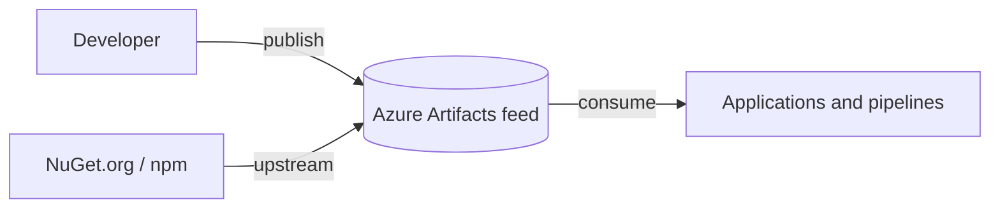

**Azure App Configuration** centralizes application settings and feature flags for many apps. It is fully managed, encrypts sensitive data at rest and in transit, and integrates with popular frameworks.

</details>

---

### 11. Security and Compliance

<details>
<summary><b>Shift-left security, Key Vault, and OWASP ZAP</b></summary>

Security should be built into every stage, not added at the end.

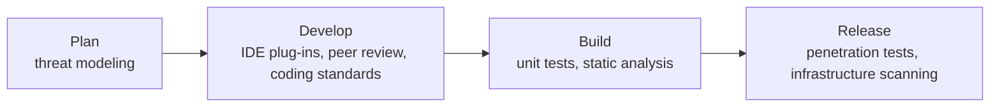

#### Azure Key Vault

Instead of storing passwords and connection strings in code or configuration, keep them as **secrets** in Key Vault and let the application or pipeline retrieve them at runtime.

#### OWASP ZAP in a pipeline

A dynamic security scan can be added to a pipeline:

1. Deploy the web app.
2. Run the ZAP scanner from a container instance against the site.
3. Save the report to a storage account file share.
4. Convert the report and publish it as test results.

</details>

---

### 12. Testing with Azure Test Plans

<details>
<summary><b>Plans, suites, cases, and the Test Runner</b></summary>

Azure Test Plans supports planned manual testing, user acceptance testing, exploratory testing, and stakeholder feedback, with traceability back to user stories.

| Item | Role |
|---|---|
| **Test plan** | Groups suites and cases for a goal or release |
| **Test suite** | Groups cases into scenarios |
| **Test case** | Defines the steps needed to verify behavior |
| **Shared steps** | Reusable steps across cases |

- **Test Runner** runs manual tests for web and desktop apps, marks pass or fail, and can capture screenshots and screen recordings.
- **Test & Feedback extension** is a browser extension for exploratory testing and stakeholder feedback on web apps.
- Test cases link to work items, and Test Plans integrates with Pipelines for end-to-end traceability.

**Access:** creating plans and suites needs the *Basic + Test Plans* level; Basic users can execute tests and analyze results; Stakeholders can give feedback through exploratory tools.

</details>

---

### 13. Monitoring and Instrumentation

<details>
<summary><b>Log Analytics, Azure Monitor, Service Map, and Application Insights</b></summary>

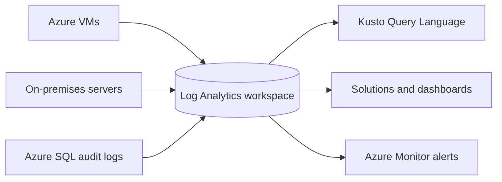

**Log Analytics workspace:** the central store for logs from many sources, queried with Kusto Query Language (KQL).

```kusto
Heartbeat
| where TimeGenerated > ago(1h)
| summarize LastSeen = max(TimeGenerated) by Computer
```

**Azure Monitor dynamic thresholds:** machine learning learns the historical behavior of a metric and flags anomalies.

| Sensitivity | Behavior |
|---|---|
| High | Alerts on even small deviations |
| Medium | Balanced thresholds, fewer alerts |
| Low | Alerts only on large deviations |

**Service Map:** discovers application components on Windows and Linux machines and shows server connections and latency. Machines must report to a Log Analytics workspace and have the Dependency agent installed.

**Application Insights:** application performance management for live web apps (.NET, Node.js, Java, Python), whether hosted in Azure, on-premises, or elsewhere. It uses an SDK or agent with minimal overhead.

| Feature | What it answers |
|---|---|
| Users, Sessions, Events | Who uses the app and which features |
| Funnels | Where users drop out of a multi-step process |
| Cohorts | How a specific group behaves |
| Impact | How load times affect conversion |
| Retention | How many users come back |
| User flows | Where users click, churn, or repeat actions |

</details>

---

### 14. Project Administration

<details>
<summary><b>Free tier and organization structure</b></summary>

Each Azure DevOps organization includes a free tier of services for a small number of users: Pipelines, Boards, Repos, Artifacts, and unlimited Stakeholders. Check the official documentation for current limits before planning a team. Organizations can hold multiple projects, which is useful for separating business units.

</details>

---

## Workflow

The end-to-end change flow I follow when working through these topics:

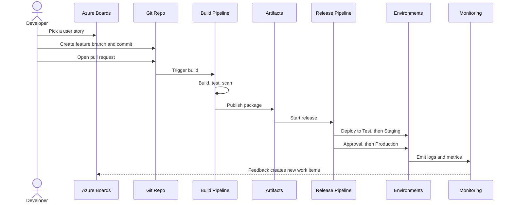

<details>
<summary><b>Step-by-step explanation</b></summary>

1. **Plan:** the work item is refined and added to the sprint backlog.
2. **Code:** a short-lived feature branch is created and commits are pushed.
3. **Review:** a pull request gates the merge into `main`.
4. **Integrate:** the pipeline builds the code, runs tests, and performs static analysis.
5. **Package:** the build artifact or package is published.
6. **Release:** the artifact is promoted through test and staging, with approvals and gates.
7. **Deploy:** a safe strategy (slots, blue-green, canary) is used to reach production.
8. **Operate and monitor:** telemetry reveals problems and informs the next iteration.

</details>

---

## Prerequisites

- An Azure subscription (a free account is enough for practice)
- An Azure DevOps organization and project
- Git installed locally
- Visual Studio Code or Visual Studio
- .NET SDK (6.0 or later) for the sample application
- Docker Desktop
- Azure CLI
- Terraform CLI
- Basic familiarity with the command line

---

## Installation

```bash
# 1. Clone the repository
git clone https://github.com/<your-username>/<your-repo>.git
cd <your-repo>

# 2. Verify tooling
git --version
az --version
terraform -version
docker --version
dotnet --version

# 3. Sign in to Azure
az login

# 4. Add the Azure DevOps extension for the CLI
az extension add --name azure-devops
```

---

## Configuration

<details>
<summary><b>Azure DevOps and Azure CLI defaults</b></summary>

```bash
az devops configure --defaults \
  organization=https://dev.azure.com/<your-org> \
  project=<your-project>
```

**Recommended setup**

- Create a project with a Git repository and enable Boards, Pipelines, and Artifacts.
- Add a **service connection** from Azure DevOps to your Azure subscription for deployments.
- Store secrets in **Azure Key Vault** and reference them through variable groups instead of committing them.
- Protect `main` with a branch policy requiring pull requests and a successful build.
- Create `test`, `staging`, and `production` environments with approvals on production.

</details>

---

## Usage

<details>
<summary><b>Common tasks</b></summary>

**Create a feature branch and open a change**

```bash
git checkout -b feature/job-posting
git add .
git commit -m "Add job posting form"
git push -u origin feature/job-posting
```

**Run a pipeline from the CLI**

```bash
az pipelines run --name my-ci-pipeline --branch main
```

**Provision infrastructure with Terraform**

```bash
terraform init
terraform plan -out tfplan
terraform apply tfplan
```

**Swap a deployment slot**

```bash
az webapp deployment slot swap \
  --resource-group my-rg \
  --name my-webapp \
  --slot staging \
  --target-slot production
```

</details>

---

## Architecture Diagram

Reference architecture combining the major services:

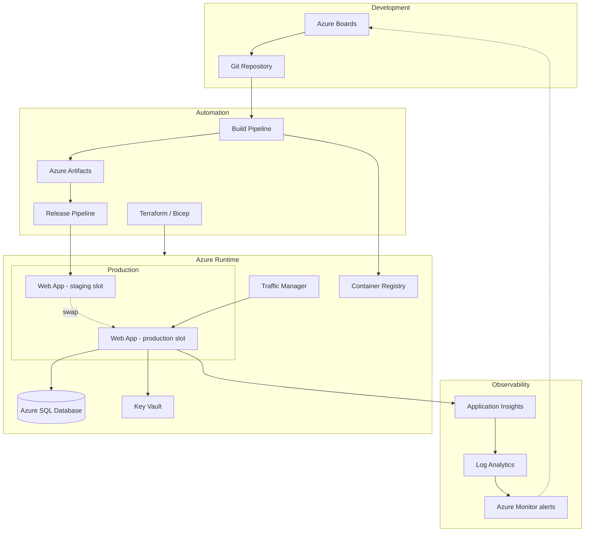

---

## Best Practices

> [!TIP]
> Automate everything that is repeated: builds, tests, deployments, and infrastructure.

- **Keep changes small.** Frequent small merges are far easier to diagnose than large batches.
- **Protect `main`.** Require pull requests, reviews, and passing builds.
- **Version everything.** Application code, pipeline YAML, and infrastructure files all belong in Git.
- **Separate environments.** Promote the same artifact through test, staging, and production instead of rebuilding.
- **Use approvals and gates** for production changes.
- **Never store secrets in source control.** Use Key Vault and secure variable groups.
- **Prefer declarative IaC** (Bicep or Terraform) so environments are reproducible.
- **Use safe release patterns** such as deployment slots, blue-green, or canary with feature flags.
- **Shift security left.** Add static analysis, dependency checks, and scanning to pipelines.
- **Monitor and alert on meaningful signals.** Use dynamic thresholds to reduce noise.
- **Hold retrospectives.** Continuous improvement applies to the process as much as the product.

> [!WARNING]
> ARM **Complete** deployment mode deletes resources in the target resource group that are not in the template. Preview with `what-if` before running it.

> [!NOTE]
> Keep Terraform state in a remote, access-controlled backend when working in a team, and never commit it to Git.

---

## Troubleshooting

<details>
<summary><b>Common issues and fixes</b></summary>

| Symptom | Likely cause | Fix |
|---|---|---|
| Pipeline does not trigger | Trigger branch or path filter does not match | Check the `trigger` section and branch names |
| Pipeline waits for an agent | No parallel job available or the self-hosted agent is offline | Verify parallelism and agent status |
| `.NET` app fails on the target machine | Runtime not installed | Install the matching .NET runtime or hosting bundle |
| Deployment succeeds but site shows errors | Missing app settings or secrets | Check configuration, Key Vault access, and connection strings |
| Cannot access repos or Test Plans | Access level too low | Raise the user's access level (Basic, or Basic + Test Plans) |
| Cannot save a shared query | Missing permission | Needs Project Administrator rights and Basic access |
| `terraform apply` wants to recreate resources | State drift or renamed resources | Run `terraform plan`, review, and import or refactor as needed |
| Unexpected resources deleted after ARM deployment | Complete mode used | Use Incremental mode or run `what-if` first |
| Slot swap breaks the app | Slot-specific settings not marked | Mark environment-specific settings as slot settings |
| Merge conflict | Both branches edited the same lines | Resolve in the editor, then `git add` and commit |

</details>

---

## References

- [Azure DevOps documentation](https://learn.microsoft.com/azure/devops/)
- [Azure Pipelines YAML schema](https://learn.microsoft.com/azure/devops/pipelines/yaml-schema/)
- [Azure DevOps security and permissions](https://learn.microsoft.com/azure/devops/organizations/security/about-permissions)
- [Azure Test Plans overview](https://learn.microsoft.com/azure/devops/test/overview)
- [Azure Resource Manager templates](https://learn.microsoft.com/azure/azure-resource-manager/templates/)
- [Bicep documentation](https://learn.microsoft.com/azure/azure-resource-manager/bicep/)
- [Terraform documentation](https://developer.hashicorp.com/terraform/docs)
- [Pro Git book](https://git-scm.com/book)
- [Azure Monitor documentation](https://learn.microsoft.com/azure/azure-monitor/)
- [Application Insights overview](https://learn.microsoft.com/azure/azure-monitor/app/app-insights-overview)

---

## Conclusion

Working through this material gave me a connected view of the whole delivery chain: how Agile planning feeds Git workflows, how pipelines automate integration and release, how infrastructure becomes repeatable through code, and how monitoring closes the loop. The most important lesson is that DevOps is as much about collaboration and feedback as it is about tools.

I plan to keep extending this repository with hands-on labs, pipeline samples, and Terraform modules as I build and document them.

---

## Author

**Author:** Chennavaram Irfan

